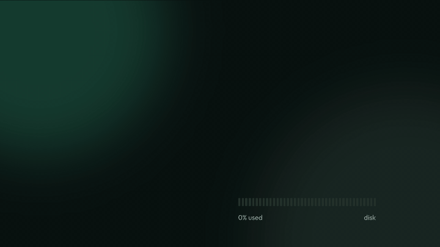
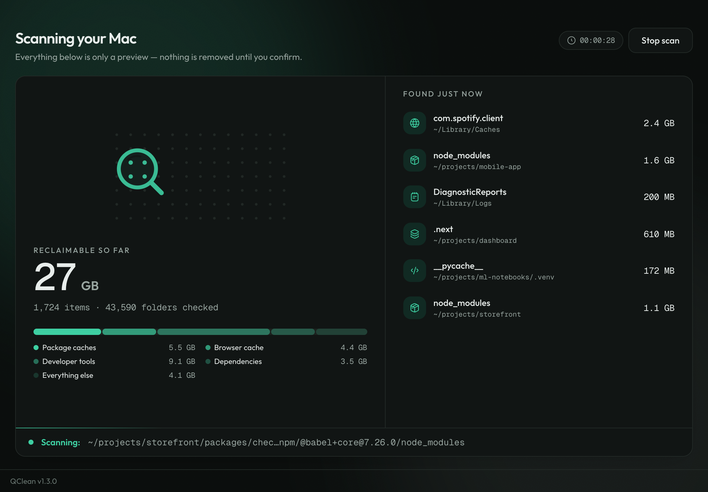

<div align="center">



# QClean

A native desktop utility for **macOS, Linux and Windows** that finds
safe‑to‑remove **caches, build output and developer leftovers**, lets you review
exactly what will go, and deletes only what you choose. On macOS it also includes
**Keyboard Cleanup** mode, which locks the keyboard at the OS level so you can
wipe it down without stray keystrokes reaching your Mac.



</div>

> [!CAUTION]
> QClean **permanently deletes** files — removed items do **not** go to the
> Trash and cannot be recovered by QClean or macOS afterward. This is a
> cleanup tool with real potential for accidental data loss if you are not
> careful: always review the results list before confirming, and note that
> every deletion requires an explicit, separate "I understand this is
> permanent" confirmation in the app — it never deletes silently.

<div align="center">

[](https://github.com/febritecno/qclean/actions/workflows/ci.yml)
[](https://github.com/febritecno/qclean/actions/workflows/release.yml)
[](https://github.com/febritecno/qclean/releases/latest)
[](https://github.com/febritecno/qclean/releases)
[](LICENSE)

Self‑contained desktop application:

**Svelte 5 · TypeScript · Vite · Tauri 2 · Rust · Tailwind CSS**

</div>

---

<div align="center">



</div>

---

## Features

- **Two modes** — _Safe_ (caches + dependency folders) and _Aggressive_ (also
  build output, compiled artefacts, `*.pyc`).
- **Three scopes** — _Projects_ (`~/projects`), _User home_ (`~` + user caches),
  _Full Mac_ (all user homes + system cache locations). Plus extra folders via
  the UI or the `QCLEAN_EXTRA_SCAN_ROOTS` environment variable.
- **21 recursive rules** (`node_modules`, `__pycache__`, `.next`, `target`,
  `.gradle`, `dist`, `.DS_Store`, …) + **14 user** + **6 system** exact cache
  rules — ported verbatim from the Python app. See _What QClean cleans_ in the
  app, or [`docs/migration/feature-inventory.md`](docs/migration/feature-inventory.md).
- **App leftovers** — every scan also lists `~/Library` data of apps that are
  no longer installed: entries named after a bundle identifier when nothing
  from that vendor is installed, and `Application Support` folders named after
  an app when no installed app or macOS component has a similar name and
  nothing inside has changed for 90 days. It also lists `Group Containers`
  of removed apps and launch agents in `~/Library/LaunchAgents` whose program no
  longer exists. A dead launch agent, or a leftover privileged helper, no longer
  counts as proof that its vendor is installed, nor does a browser's web-app
  shortcut. A dead link in `~/.local/bin` into a removed `.app` is listed, and
  data named after that app is listed at once instead of after 90 days. Never
  selected automatically.
- **Native, cancellable scanner** — parallel byte sizing, incremental streamed
  results, time‑based progress (at most every 100 ms, including while it sizes
  a large cache), per‑error tolerance, never follows symlinked directories,
  de‑duplicates by canonical path.
- **Live scan view** — the reclaimable total counts up as items are found, a
  bar shows which categories the space comes from, a _Found just now_ feed
  lists the newest finds, and the status bar shows the folder being read
  (long paths trimmed in the middle). Updates are paced on a steady clock, so
  the screen stays calm however fast results arrive.
- **Virtualised results** — search, category sidebar, sort, per‑row _Show in
  Finder_, select‑all / clear, running "selected · reclaimable" totals.
- **Defensive deletion** — permanent (not Trash), with a per‑item outcome
  breakdown: Deleted / Skipped / Failed / Permission denied / Already gone /
  Changed / Protected.
- **Permissions‑aware** — detects Full Disk Access, explains how to grant it,
  reports every location it could not read. Never runs as `root`.
- Light **and** dark, `prefers-reduced-motion` honoured (animations stop and
  show their final state), keyboard‑operable dialogs.
- **Keyboard Cleanup Mode** — locks the keyboard at the OS level so you can
  wipe it down without stray keystrokes reaching the Mac.

---

## Supported platforms

| Platform                                | Status                                                         | What is cleaned                                                                             |
| --------------------------------------- | -------------------------------------------------------------- | ------------------------------------------------------------------------------------------- |
| **macOS 11+** (Apple Silicon and Intel) | Built, run and tested                                          | Everything below, plus system caches, app leftovers and Keyboard Cleanup                    |
| **Linux**                               | Engine type‑checked and unit‑tested in CI; not yet run by hand | Project folders, `~/.cache`, Trash, package‑manager caches                                  |
| **Windows 10+**                         | Engine type‑checked and unit‑tested in CI; not yet run by hand | Project folders, `%LOCALAPPDATA%\Temp`, browser caches, crash dumps, package‑manager caches |

System‑wide cache locations are macOS‑only: on Linux and Windows they need
administrator rights, and QClean never runs elevated. The protected‑path policy
is defined per platform in `src-tauri/crates/qclean-core/src/safety.rs`.

---

## Install

1. Download `QClean_<version>_universal.dmg` from the
   [latest release](https://github.com/febritecno/qclean/releases/latest).
2. Open the DMG and drag **QClean** into _Applications_.
3. Open the app. Builds are notarised only when the release was Developer‑ID
   signed (see [`docs/signing.md`](docs/signing.md)). An unsigned build is
   blocked on first launch: open _System Settings ▸ Privacy & Security_ and click
   **Open Anyway**. If macOS says QClean "is damaged and can't be opened", that's
   the download quarantine flag, not a broken file. Clear it and open again:
   ```bash
   xattr -cr /Applications/QClean.app
   ```
4. For system‑level cache locations, grant **Full Disk Access**:
   _System Settings ▸ Privacy & Security ▸ Full Disk Access_ → enable **QClean**
   → re‑scan. QClean works without it, but _Full Mac_ scans will skip protected
   directories (and say so).

---

## Build from source

### Prerequisites

- macOS 11+
- [Rust](https://rustup.rs) (stable) with the `aarch64-apple-darwin` target
- [Node.js](https://nodejs.org) 20+

```bash
git clone https://github.com/febritecno/qclean.git
cd qclean
npm ci
```

### Develop

```bash
npm run tauri dev        # hot-reloading app window
```

### Package

```bash
npm run tauri build -- --target aarch64-apple-darwin      # Apple Silicon
npm run tauri build -- --target universal-apple-darwin    # universal (needs both targets)
```

Artifacts land in `src-tauri/target/<target>/release/bundle/` (`.app` and `.dmg`).

### Checks

```bash
npm run check                       # svelte-check
npx prettier --check .              # formatting
npm run test                        # Vitest (frontend)

cd src-tauri
cargo fmt --all --check
cargo clippy --workspace --all-targets -- -D warnings
cargo test --workspace              # 55 unit + integration tests
```

### Regenerate icons

`assets/icon-1024.png` is the icon master; `assets/icon.svg` is the editable
source. `assets/icon-animated.svg` is the animated version (the Q draws itself,
then the sparkle twinkles); a copy in `static/app-icon-animated.svg` is used by
the About dialog, so keep the two in sync — `npm run icons` does not generate
them.

```bash
# drop a new assets/icon-1024.png (or edit assets/icon.svg with
# @resvg/resvg-js installed), then:
npm run icons
```

---

## Architecture

```
Svelte 5 (SvelteKit SPA)
        │  @tauri-apps/api  invoke / listen
        ▼
Tauri commands  (src-tauri/src/commands.rs)      ── scan://* · cleanup://* events
        ▼
qclean-core   (src-tauri/crates/qclean-core) ── pure Rust, no UI, no Tauri
  ├─ safety   path normalisation + protected-path policy
  ├─ rules    the cleanup-rule catalogue (1:1 with the Python app)
  ├─ scope    scan-scope → filesystem roots, home discovery
  ├─ scanner  cancellable, incremental, error-tolerant walk
  ├─ session  scan-session registry + delete-time validation gate
  ├─ deleter  defensive deletion with per-item outcomes
  └─ sysinfo  disk usage, admin check, Full Disk Access probing
        ▼
macOS filesystem / system APIs
```

- The **frontend never constructs a filesystem path.** It sends opaque
  _candidate ids_ from a scan session that Rust itself produced.
- Every deletion re‑runs the eight safety checks (session valid, candidate in
  session, still inside a permitted root, still not protected, unchanged since
  the scan, operation allowed, still exists, not a protected path) — see
  [`docs/security/deletion-safety.md`](docs/security/deletion-safety.md).
- Full details: [`docs/architecture.md`](docs/architecture.md).

---

## Permission requirements

QClean is **not sandboxed** (it must read/remove caches across your home and,
with Full Disk Access, system cache locations) but **is** built with the Hardened
Runtime. It never uses `sudo`. When macOS denies a path, QClean records it and
shows it — it never claims a protected path was cleaned.

QClean asks for two **independent** macOS permissions, each gated behind its
own toggle in _System Settings ▸ Privacy & Security_ — granting one has no
effect on the other, and both can be revoked at any time.

| Permission           | Needed for                                                                                                                                                                                        | Without it                                                                                                                                                    |
| -------------------- | ------------------------------------------------------------------------------------------------------------------------------------------------------------------------------------------------- | ------------------------------------------------------------------------------------------------------------------------------------------------------------- |
| **Full Disk Access** | Reading/removing caches in TCC‑protected locations — `~/Library/Safari`, `~/Library/Mail`, `~/Library/Messages`, and (on _Full Mac_ scope) system‑wide caches under `/Library`, `/private/var/…`. | QClean still works. Those specific locations are skipped and reported as "could not be read" in the results — never silently treated as cleaned.              |
| **Accessibility**    | Only **Clean Mode** — the system‑wide keyboard lock (`toggle_keyboard_lock`) used to safely wipe down your keyboard without stray keystrokes reaching QClean or any other app.                    | Nothing else in QClean needs it. Clean Mode just cannot engage until it is granted — the app links you straight to the right settings pane when that happens. |

Both are checked live and surfaced in the in‑app **Permissions** dialog (with
one‑click links to the exact System Settings pane for each), not just at
install time. Full details — exactly what is probed, how denials propagate
through a scan, and the signed‑vs‑ad‑hoc caveat for Full Disk Access —
live in [`docs/permissions.md`](docs/permissions.md).

---

## Safety model

- Deletion is **only** allowed for items discovered in the **current** scan
  session (1 h TTL, 24‑session cap).
- Protected paths — `/`, `/System`, `/Library`, `/Users`, `/Applications`,
  `/private`, `/usr`, `/opt/homebrew`, your home folder and its top‑level folders,
  every "children" cache‑rule base, any `/Volumes/<name>` root, anything shallower
  than 3 real path components — are never listed and never deleted.
- `..` / symlink / firelink / case tricks are resolved before any check.
- `remove_dir_all` never follows symlinks; a symlinked candidate is unlinked, not
  traversed.
- Deletions are **permanent** — the confirmation dialog says so.

---

## Contributing

See [`CONTRIBUTING.md`](CONTRIBUTING.md). In short: Conventional Commits, keep
`cargo clippy -D warnings` / `svelte-check` / `prettier` / both test suites green,
put filesystem logic in `qclean-core` (with tests), keep the frontend
presentation‑only.

---

## License

Apache License 2.0. QClean is a fork of [MacClean](https://github.com/bkrajendra/macclean), © 2026 bkrajendra. See [`LICENSE`](LICENSE).
